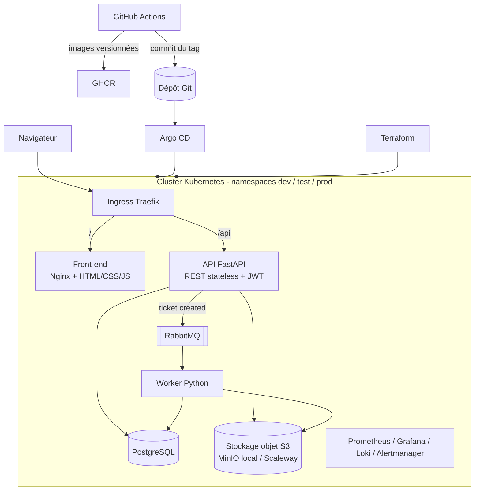

# EnergyDesk

**Conception, déploiement et exploitation cloud-native d'une application de gestion des incidents techniques de comptage électrique.**

Projet de validation du bloc BC3 — « Implémenter et automatiser le déploiement des solutions de données sur le cloud et on-premise » (compétences C6.1 à C8.2).

> ⚠️ **Données exclusivement fictives.** EnergyDesk ne communique avec aucun compteur réel, aucun système d'exploitation électrique et aucune base de données d'entreprise. Les identifiants d'équipement suivent un format fictif : `CPT-FICTIF-000123`.

## 1. Fonctionnalités

- Inscription et connexion sécurisées (Argon2id, JWT).
- Tickets : création, liste filtrée, détail, statut (agent), attribution (agent), commentaires, pièces jointes.
- Tableau de bord métier : tickets ouverts, en cours, résolus, critiques.
- Notification asynchrone à la création d'un ticket (RabbitMQ, puis worker).
- Deux rôles : `user` (ne voit que ses tickets) et `agent` (gère tous les tickets).

## 2. Architecture



| Service | Rôle | Technologie |
|---|---|---|
| `frontend` | Pages web servies seules ; relaie `/api` en Docker Compose | Nginx non privilégié, HTML/CSS/JS, CSP stricte |
| `api` | API REST stateless, authentification, règles métier | Python 3.12, FastAPI, SQLAlchemy 2, Alembic |
| `worker` | Notification à la création d'un ticket, idempotente, avec rattrapage | Python, pika, psycopg |
| `postgres` | Données persistantes | PostgreSQL 16 (managé en cloud) |
| `object storage` | Pièces jointes, notifications, sauvegardes | MinIO (local), Scaleway Object Storage (cloud) |
| `rabbitmq` | File de messages (exchange `energydesk.events`, file `ticket.created`, DLQ) | RabbitMQ 4 |

Détails : [docs/deploiement.md](docs/deploiement.md), [docs/observabilite.md](docs/observabilite.md), [docs/securite-iso27001.md](docs/securite-iso27001.md), [docs/finops.md](docs/finops.md).

## 3. Structure du dépôt

```text
energydesk/
├── backend/                 API FastAPI, migrations Alembic, tests (pytest)
├── worker/                  Worker RabbitMQ, tests
├── frontend/                Pages HTML/CSS/JS, configuration Nginx
├── docker-compose.yml       Pile complète en local
├── deploy/
│   ├── helm/energydesk/     Chart Helm + values-dev/test/prod/cloud.yaml
│   ├── argocd/              AppProject et Applications (GitOps)
│   └── k8s/                 Jobs ponctuels (test de restauration, test de charge)
├── infra/terraform/
│   ├── local/               Namespaces, quotas, Traefik, observabilité, Argo CD
│   └── cloud/               Scaleway : VPC, Kapsule, PostgreSQL, Object Storage, IAM
├── observability/values/    Configuration Prometheus/Grafana, Loki, Alloy
├── .github/workflows/       ci.yml (pipeline), promote.yml (promotion)
├── .devcontainer/           Environnement Codespaces (Kubernetes)
├── scripts/                 Scripts PowerShell (démo, secrets, sauvegarde, mesures)
└── docs/                    Guide d'exécution, cadrage, sécurité, FinOps, preuves, rapport
```

## 4. Démarrage rapide (Docker Compose, Windows)

Prérequis : Docker Desktop, Git, PowerShell.

```powershell
Copy-Item .env.example .env          # remplacer chaque "change-me"
docker compose up -d --build
docker compose ps                    # services healthy, migrate en exited (0)
.\scripts\demo-compose.ps1           # scenario metier complet
```

- Application : http://localhost:8080
- Documentation de l'API : http://localhost:8080/api/docs
- Console RabbitMQ : http://localhost:15672
- Console MinIO : http://localhost:9001

## 5. Kubernetes, CI/CD, cloud

Le pas-à-pas complet est dans **[docs/guide-execution.md](docs/guide-execution.md)** :

1. Pipeline GitHub Actions : lint, tests, scans Trivy, validation Helm et Terraform, build, publication GHCR, mise à jour GitOps.
2. Cluster dans GitHub Codespaces : `pwsh ./scripts/cluster-up.ps1` (Minikube ou k3d) puis Terraform local.
3. Déploiement par Argo CD (`deploy/argocd/`).
4. Infrastructure cloud Scaleway : `terraform -chdir=infra/terraform/cloud apply`.

## 6. Tests

```powershell
# PostgreSQL de test
docker run -d --name ed-test-db -e POSTGRES_USER=energydesk -e POSTGRES_PASSWORD=test -e POSTGRES_DB=energydesk_test -p 5433:5432 postgres:16-alpine
cd backend
python -m venv .venv; .\.venv\Scripts\Activate.ps1
pip install -r requirements-dev.txt
$env:DB_PORT = "5433"; pytest
```

Couverture : authentification, contrôle d'accès (403/404), validation, transitions de statut, attribution, commentaires, pièces jointes (taille, type réel, nom), stockage S3, sauvegarde, métriques, correspondance migrations/modèles. Worker : idempotence, DLQ, rattrapage, requêtes SQL sur PostgreSQL réel.

## 7. Sécurité

Aucun secret n'est versionné. `.env`, `terraform.tfvars`, les états Terraform et les kubeconfig sont ignorés par Git. Les secrets Kubernetes sont créés hors Git (`scripts/create-k8s-secrets.ps1`). Le pipeline n'utilise que le `GITHUB_TOKEN`, avec des permissions minimales.

## 8. Suivi

L'état de chaque exigence est tenu dans [docs/matrice-conformite.md](docs/matrice-conformite.md).
